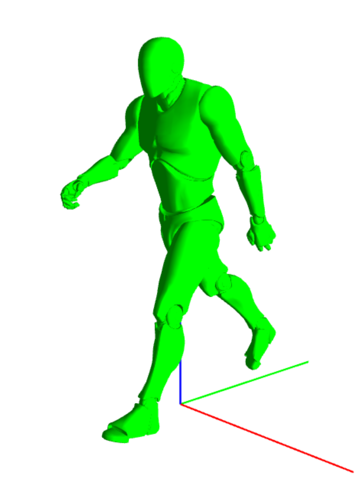

# Animation Programming

A skeletal animation system built in C++ on top of an existing school framework (Whitebox), developed as a solo 2nd-year school project. It covers skeleton extraction, animation sampling, GPU skinning, interpolation and animation crossfading, with all the math coming from my own library.

---

## Table of Contents

- [Overview](#overview)
- [Screenshots](#screenshots)
- [Core Features](#core-features)
- [Animation Pipeline](#animation-pipeline)
- [Controls](#controls)
- [Implementation Highlights](#implementation-highlights)
- [Tech Stack](#tech-stack)
- [Custom Libraries](#custom-libraries)
- [Build](#build)

---

## Overview

The goal of this project is to understand skeletal animation and the math behind it. Starting from a provided codebase, which exposes the skeleton, the animation data and a skinned mesh through `Engine.h`, the project rebuilds the whole animation pipeline: bind pose, animation playback, skinning matrix computation, interpolation between keyframes, and blending between animations.

The character model and animations come from Unreal Engine 4 (1 unit = 1 cm), and animations are sampled at 30 frames per second.

## Screenshots

*Skinned mesh playing the Walk animation*


## Core Features

- **Skeleton extraction** from the engine into custom data structures (IK bones ignored)
- **Bind pose rendering** with debug lines
- **Animation playback** at 30 keyframes per second, drawn as a wireframe skeleton
- **GPU skinning** (linear blend skinning)
  - Skinning matrices computed on the CPU and sent to the vertex shader as a matrix palette
  - Hand-written `skinning.vs` vertex shader using bone indices and weights
- **Linear sampling** between keyframes
  - Interpolation of the rotation/translation (quaternion + translation) of each joint, never of matrices
  - Lerp for translations, Slerp for rotations
- **Crossfading** from Walk to Run
  - Weighted blending between source and destination animations
  - Playback speed (time scale) normalized during the transition so both cycles stay in phase

## Animation Pipeline

```
Init:   Engine skeleton + animation data
        -> Skeleton / Animation / Joint structures (local bind pose, parent indices)

Update: Time -> Keyframe pair + interpolation ratio
        -> Interpolate joint pose (Slerp / Lerp)
        -> (Crossfade) blend source and destination poses
        -> Local pose -> Global pose (walk the hierarchy)
        -> Global pose * inverse bind pose = skinning matrix
        -> SetSkinningPose (matrix palette)
        -> skinning.vs: position = sum(weight_i * M_i * position)
```

## Controls

| Key | Action |
|---|---|
| `W` / `A` / `S` / `D` | Move the camera in the scene |
| Mouse + `LMB` | Look around |

## Implementation Highlights

- **No matrix interpolation** - poses are interpolated as quaternion + translation, because interpolating rotation matrices gives non-orthonormal results
- **Exact math** - Slerp is used for rotations, with no NLerp approximation
- **Matrix palette skinning** - skinning matrices are computed on the CPU, so inverse bind poses never need to be sent to the shader
- **Phase-correct crossfade** - the destination animation's time scale is interpolated from `duration2 / duration1` to `1` during the blend, which removes the arm and leg glitches that appear otherwise
- **Init-only engine access** - skeleton and animation data are cached in custom structures so the update loop does not query the engine
- **Skeleton limits** - IK bones (`ik_...`) are skipped to stay under Whitebox's 64-bone limit

## Tech Stack

Written in C++ on Windows (x86), using:

| Purpose | Library |
|---|---|
| Window, mesh, skeleton and animation data, shaders | Whitebox (provided school framework) |
| Math | [LibMath](https://github.com/Potatoes251/LibMath) (custom, in-house) |

No third-party library such as GLM is used.

## Custom Libraries

- **LibMath** - my own math library (`Vector3`, `Quaternion`, `Matrix4`, Lerp, Slerp, matrix inverse, ...), developed as a separate school project and reused here

## Build

The project uses a **Visual Studio** solution.

> Whitebox is only compatible with **x86**. The project does not build in x64.

### Requirements

- Windows
- Visual Studio 2022 (MSVC) with the x86 toolchain
- C++14 compiler support

### 1. Clone and open
 
```bash
git clone https://github.com/Potatoes251/Animation.git
```
 
Open the `.sln` file in Visual Studio.
 
### 2. Build and run
 
1. Select the **x86** platform (not x64) and **Debug** or **Release**.
2. Build and run (`F5` or `Ctrl+F5`).
Keep the `Data/` folder (shaders, meshes, animations) reachable from the working directory.

### Notes
- If the mesh disappears without any change on your side, relaunch the program: Whitebox is sometimes unstable.
- The provided Walk animation is missing a frame, which causes a small stutter when it loops.
- Build outputs (`build/`, `.exe`, `.obj`, `.vs/`) are excluded from the repository via `.gitignore`.
